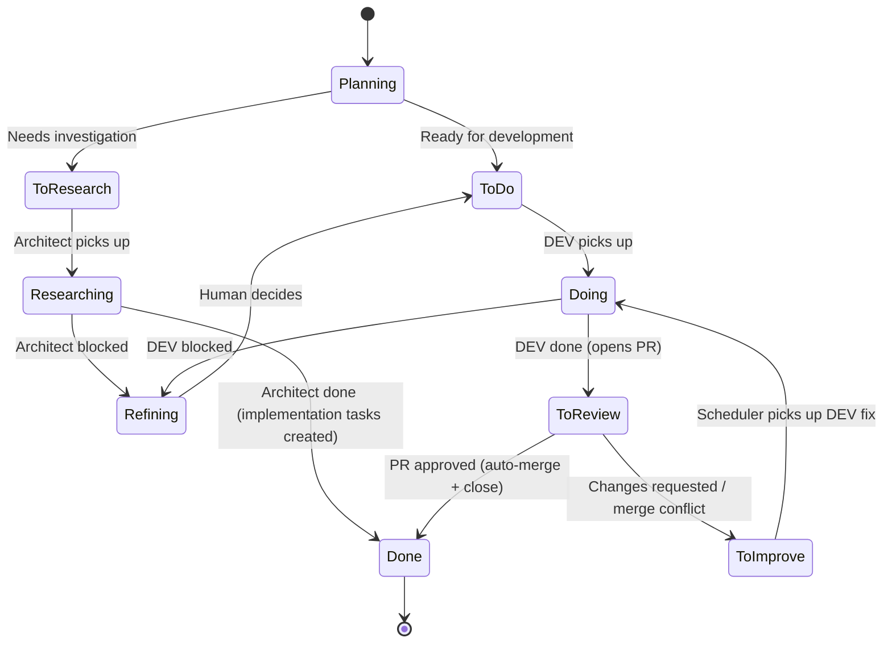

# DevClaw — Workflow Reference

The issue lifecycle in DevClaw is a configurable state machine defined in `workflow.yaml`. This document covers the default pipeline, all state types, review policies, and the optional test phase.

For config file format and location, see [Configuration](CONFIGURATION.md).

## PR Linkage Contract

DevClaw owns issue closure. Developer-created PR descriptions must not use provider auto-close keywords such as `Closes #N`, `Fixes #N`, or `Resolves #N`, because those can close the issue before DevClaw finishes review and test transitions.

Use safe linkage text instead:

```text
Addresses issue #N.
```

GitHub `closingIssuesReferences` being empty is expected under this contract. Provider labels and PR links are visual projection; `issues.json` and the workflow state machine remain runtime authority.

---

## Default Pipeline

```
Planning → To Do → Doing → To Review → PR approved → Done (auto-merge + close)
```

Human review, no test phase. Approved PRs are auto-merged and the issue is closed.



---

## Workflow States

Each state has a type, label, color, and optional transitions. The complete default graph is maintained in [`defaults/devclaw/workflow.yaml`](../defaults/devclaw/workflow.yaml). Sparse overrides inherit that graph:

```yaml
workflow:
  reviewPolicy: human
  testPolicy: skip
```

The default graph includes `toTest` and `testing`. Review transitions enter `toTest`; a local `testPolicy: skip` snapshot follows its `SKIP` transition to `done` without dispatching a tester.

Every entry under `on` must use an object with a required `target`. Optional
`actions` and `description` fields extend the same shape. String shorthand such
as `PICKUP: doing` is invalid.

The architect role has dedicated `To Research` and `Researching` states. Design tasks are triggered via the `research_task` tool, which creates an issue and transitions it through `To Research` → `Researching`. The architect posts findings as comments, creates implementation tasks in Planning, and completes with `work_finish`.

### Managed Issue Projection

For initialized DevClaw-managed issues, `devclaw/projects/<project>/issues.json` is the runtime authority. Provider labels are required visual projection, not truth. The required `eyes` reaction remains a visual compatibility marker for managed issues and PRs.

- Queue dispatch uses local `workflowState`/`workflowLabel` when a local issue record exists.
- Provider labels remain visible in GitHub/GitLab and in `task_list`/`tasks_status`.
- Manual provider label edits do not mutate local state.
- If the provider issue no longer exists in GitHub/GitLab, heartbeat normally treats that as task deletion. An unresolved worker delivery retains its slot for investigation instead of requeueing from absence alone.
- Heartbeat repairs recoverable managed-label drift and preserves unmanaged human labels.
- Missing or tampered managed metadata sets `integrity_error`; repair with `devclaw repair issue --project <slug> --issue <id> --source local-state --dry-run` and then `--apply`.
- Old issues without local state are shown as `projection_uninitialized` and must be explicitly backfilled before managed dispatch.

### Child Issue Creation Invariant

When `task_create` creates an ordinary implementation task, it records a durable idempotent operation and preserves `workflow.initial`, normally the `Planning` hold state. The provider issue receives the complete initial label projection and a hidden operation marker; metadata and a fresh provider read are verified before local runtime state becomes ready. Partial or ambiguous operations remain unavailable to heartbeat and workers while safe reconciliation continues. `task_start` explicitly advances a ready held issue to its first queue. A custom workflow may intentionally declare a queue as its initial state; only a verified issue is immediately dispatchable.

When issue decomposition creates child issues, each child must be initialized as its own managed issue before it can be dispatched: create the provider issue, write its local `issues.json` record, render managed metadata, apply provider projection labels, and add the `eyes` compatibility marker. Root/container issues are not dispatchable unless they also have a normal managed runtime state.

### State Types

| Type | Description |
|---|---|
| `queue` | Waiting for pickup. Must have a `role`. Has `priority` for ordering. Can have a `check` field (e.g. `prApproved`) — heartbeat polls and auto-transitions. |
| `active` | Worker is currently working on it. Must have a `role`. |
| `hold` | Paused, awaiting human decision. |
| `terminal` | Completed. No outgoing transitions. |

### Built-in Actions

| Action | Description |
|---|---|
| `gitPull` | Pull latest from the base branch |
| `detectPr` | Auto-detect PR URL from the issue |
| `mergePr` | Merge the PR associated with the issue. Critical in review states (aborts on failure). |
| `closeIssue` | Close the issue |
| `reopenIssue` | Reopen the issue |

### Review Checks

| Check | Description |
|---|---|
| `prMerged` | Transition when the issue's PR is merged |
| `prApproved` | Transition when the issue's PR is approved or merged |

### Priority Order

Queue states are processed in priority order during each heartbeat tick:

1. **To Improve** (priority 3) — fix requests from review
2. **To Review** (priority 2) — completed work awaiting review
3. **To Do** (priority 1) — new work

Higher priority number = picked up first.

---

## Review Policy

The `reviewPolicy` field controls how PRs are reviewed after a developer completes work:

```yaml
workflow:
  reviewPolicy: human  # Options: human, agent, skip
```

| Policy | Behavior |
|---|---|
| `human` (default) | All PRs need human approval on GitHub/GitLab. The heartbeat service auto-merges when the PR is approved. PR comments or changes-requested reviews automatically move the issue to "To Improve". |
| `agent` | An agent reviewer checks every PR before merge. The reviewer agent is dispatched automatically and calls `work_finish` with approve/reject. |
| `skip` | Skip the reviewer worker and follow the configured `SKIP` transition. |

### Per-Issue Overrides

Override the project-level policy for a single issue through DevClaw-managed state. Provider labels are still rendered for visibility:

| Projected label | Local policy snapshot |
|---|---|
| `review:human` | `reviewPolicy: human` |
| `review:agent` | `reviewPolicy: agent` |
| `review:skip` | `reviewPolicy: skip` |

For initialized DevClaw-managed issues, these labels are projection from `devclaw/projects/<project>/issues.json`. Editing `review:*`, `test:*`, state, owner, or role labels or body metadata directly in GitHub/GitLab does not change runtime state. The heartbeat projection pass restores recoverable drift and marks metadata tamper as `integrity_error`.

Change existing policy snapshots through `issue_policy_migrate`. Preview the exact selection, review changed/skipped results, then apply with `dryRun: false`:

```json
{"project":"my-project","issueIds":[42],"reviewPolicy":"agent","dryRun":true}
```

Changing `workflow.reviewPolicy` affects new issue snapshots; it does not implicitly migrate existing ones. Active worker reservations are skipped. A projection failure after apply leaves the local policy committed; repeat the same migration to resume reconciliation. Provider-only issues are not initialized by migration.

**Source:** [`lib/domain/workflow/labels.ts`](../lib/domain/workflow/labels.ts) — `resolveReviewRouting()`

---

## Test Phase (optional)

By default, the tester queue follows its SKIP transition to Done. Enable automated QA through `testPolicy: agent` and tester instructions.

### Enabling the Test Phase

Set the default for new issues and ensure the tester role is enabled:

```yaml
workflow:
  testPolicy: agent
```

The built-in graph already routes review to the tester queue and defines tester completion transitions. A custom graph must explicitly connect those states and retain a `SKIP` transition for skipped snapshots.

Provide role instructions at `devclaw/prompts/tester.md` or the project override `devclaw/projects/<project>/prompts/tester.md`. If neither exists, DevClaw supplies no role-specific instructions and does not fall back to orchestrator instructions.

Existing issues retain their snapshots. To enable testing on selected existing issues, preview `issue_policy_migrate` with `testPolicy: agent`, then apply the same selection with `dryRun: false`. To skip testing on one issue:

```json
{"project":"my-project","issueIds":[42],"testPolicy":"skip","dryRun":true}
```

Review the preview before applying. Adding or removing `test:skip` on the provider never changes the local policy. `sync_labels` provisions label definitions only; it does not migrate snapshots or issue projections.

### Pipeline with Test Phase

```
Planning → To Do → Doing → To Review → PR approved → To Test → Testing → Done
```

### Tester Completion Results

| Result | Transition | Meaning |
|---|---|---|
| `pass` | Testing → Done | Approved. Issue closed. |
| `fail` | Testing → To Improve | Issues found. Issue reopened, sent back to developer. |
| `refine` | Testing → Refining | Needs human decision. Pipeline pauses. |
| `blocked` | Testing → Refining | Cannot complete (env issues, etc.). Awaits human decision. |

### Test Review Process

When the test phase is enabled, tester workers follow a structured review process:

**1. Review the Code**

- Pull latest from the base branch
- Run tests and linting
- Verify changes address issue requirements
- Check for regressions in related functionality

**2. Document the Review (required)**

Before completing, the tester MUST create a review comment using `task_comment`:

```javascript
task_comment({
  channelId: "<channel-id>",
  issueId: <issue-number>,
  body: "## Test Review\n\n**Tested:**\n- [List what you tested]\n\n**Results:**\n- [Pass/fail details]\n\n**Environment:**\n- [Test environment details]",
  authorRole: "tester"
})
```

**3. Complete the Task**

After posting the comment, call `work_finish`:

```javascript
work_finish({
  channelId: "<channel-id>",
  role: "tester",
  result: "pass",  // or "fail", "refine", "blocked"
  summary: "Brief summary of review outcome"
})
```

### Comment Templates

**Passing review:**

```markdown
## Test Review

**Tested:**
- Feature A: [specific test cases]
- Feature B: [specific test cases]
- Edge cases: [list]

**Results:** All tests passed. No regressions found.

**Environment:**
- Browser/Platform: [details]
- Version: [details]
- Test data: [if relevant]

**Notes:** [Optional observations or recommendations]
```

**Failing review:**

```markdown
## Test Review — Issues Found

**Tested:**
- [What you tested]

**Issues Found:**
1. [Issue description with steps to reproduce]
2. [Issue description with expected vs actual behavior]

**Environment:**
- [Test environment details]

**Severity:** [Critical/Major/Minor]
```

### Why Review Comments Are Required

1. **Audit Trail** — Every review decision is documented in the issue tracker
2. **Knowledge Sharing** — Future reviewers understand what was tested
3. **Quality Metrics** — Enables tracking of test coverage
4. **Debugging** — When issues arise later, we know what was checked
5. **Compliance** — Some projects require documented QA evidence

### Tester Prompt Configuration

Tester workers receive instructions via role prompt files:

- `devclaw/projects/<project>/prompts/tester.md` — project-specific
- `devclaw/prompts/tester.md` — default fallback

These prompts should instruct the tester to always call `task_comment` before `work_finish`, include specific details about what was tested, and document results and environment.

---

## Customizing the Workflow

### Adding or Modifying States

Edit `workflow.yaml` (workspace-level or per-project). Each state needs:

- `type` — one of `queue`, `active`, `hold`, `terminal`
- `label` — display name (used for issue labels)
- `color` — hex color for issue labels
- `on` — transition map: event name → `{ target, actions?, description? }`

Queue states also need:
- `role` — which role picks up work
- `priority` — pickup order (higher = first)

### Validation

Config is validated at load time with Zod schemas. Integrity checks verify:

- The initial state exists after all config layers merge
- All transition targets reference existing states
- Queue and active states reference configured roles
- Terminal states have no outgoing transitions
- Review checks reference valid check types
- State labels are unique and do not use reserved routing prefixes
- Unknown fields, events, actions, and string-form transition targets are rejected

**Source:** [`lib/state/config/schema.ts`](../lib/state/config/schema.ts)

### The `workflow_guide` Tool

Call the `workflow_guide` tool for interactive documentation. It returns comprehensive `workflow.yaml` configuration documentation, marking every field as FIXED (enum), FREE-FORM, or extendable. Use the optional `topic` parameter to narrow to a specific section: `overview`, `states`, `roles`, `review`, `testing`, `timeouts`, `overrides`.

---

## Related

- [Configuration](CONFIGURATION.md) — Config file format, roles, timeouts, and plugin scheduling
- [Tools Reference](TOOLS.md) — All 25 tools including `task_start`, `work_finish`, `task_list`, `workflow_guide`
- [Architecture](ARCHITECTURE.md) — System design, session model, heartbeat internals
